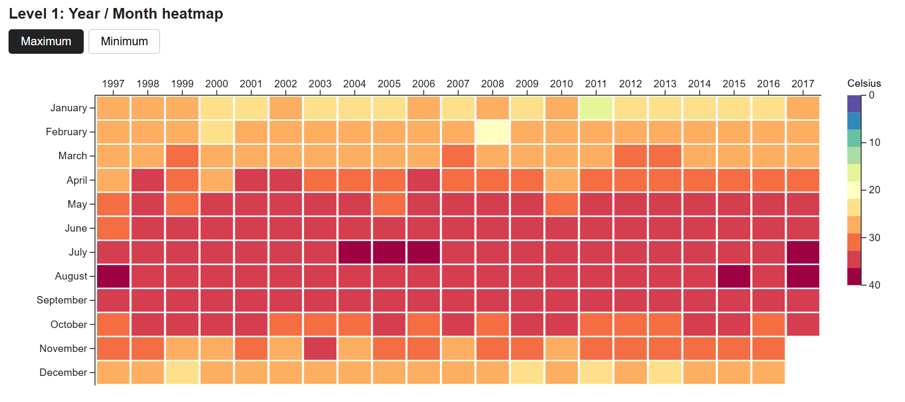
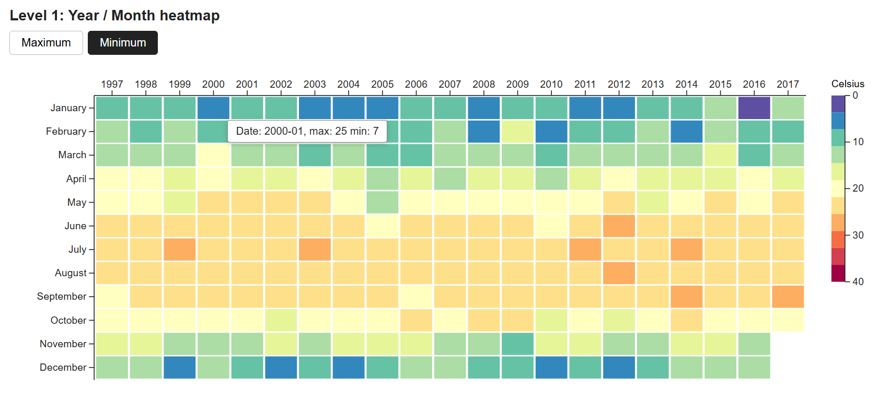
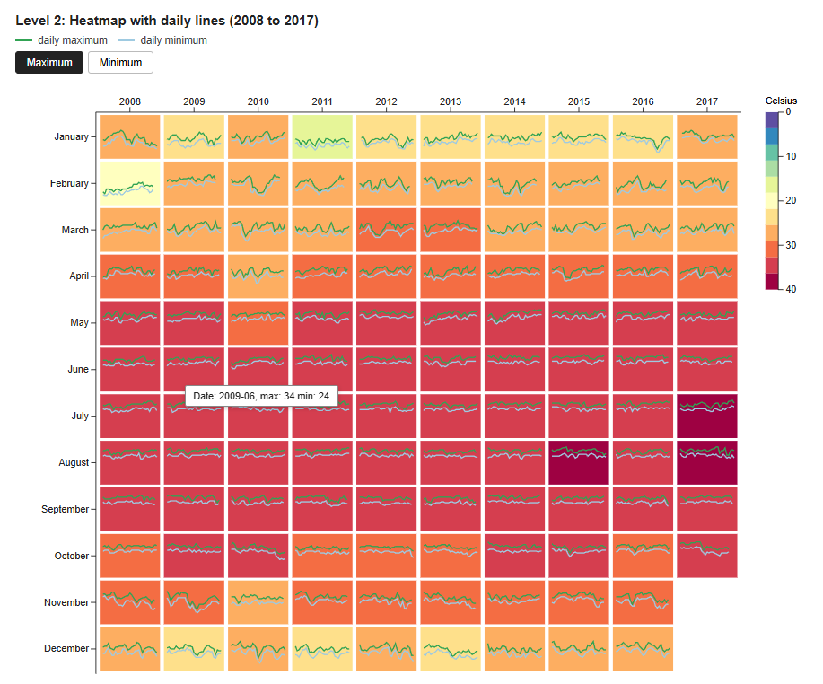
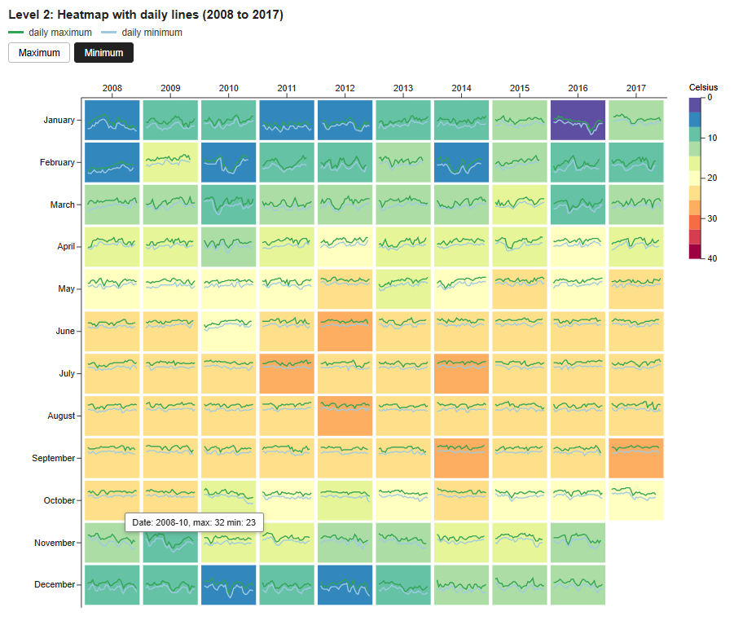

# CSCE 679 Data Visualization: Assignment 1 

Hong Kong Temperature Heatmap

For this assignment I made a heatmap of the monthly temperature in Hong Kong using D3.js. There are two levels.

- **Level 1:** a grid with years across and months down. The color of each box is the temperature.
- **Level 2:** the same grid for the last 10 years, with a small line chart inside each box.

## Output

### Level 1

Maximum temperature:



Minimum temperature:



### Level 2

Maximum temperature:



Minimum temperature:



## About the data

I used the file `temperature_daily.csv`. It has the max and min temperature for every day from 1997 to October 2017.

For each month I picked two numbers:

- **Monthly max** = the hottest day of that month
- **Monthly min** = the coldest day of that month

November and December 2017 are not in the file, so those two boxes are empty.

## What I did

### Level 1

- **Grid:** years are across the top and months are down the side. January is at the top.
- **Max and min:** there are two buttons, Maximum and Minimum. Clicking a button changes the colors.
- **Tooltip:** when I hover over a box, it shows the date and both temperatures, like `Date: 2002-03, max: 28 min: 14`.
- **Legend:** the color bar on the right goes from 0 Celsius (purple) at the top to 40 Celsius (dark red) at the bottom.

### Level 2

- **Same grid** as Level 1, but only for 2008 to 2017.
- **Lines:** each box has two lines. Green is the daily max and light blue is the daily min.
- **Line chart:** left to right is the day of the month (1 to 31). Bottom to top is the temperature (0 to 40 Celsius). Every box uses the same scale, so they are easy to compare.
- **Buttons, tooltip and legend** work the same as in Level 1.

## Colors

I used 11 colors, from purple (cold) to dark red (hot). The range 0 to 40 Celsius is split into 11 equal parts, and each part has one color. The boxes and the legend use the same colors.

## Project files

```
CSCE679-Assignment1/
  index.html                  the web page
  package.json                packages and commands
  vite.config.js              settings for Vite
  data/temperature_daily.csv  the data
  src/main.js                 all the D3 code
  src/style.css               the styling
  outputs/                pictures of the output
```

## Code

All the D3 code is in `src/main.js`:

- The settings at the top (`COLORS`, `TEMP_MIN`, `TEMP_MAX` and the line colors) can be changed to change the look.
- `start()` gets the data ready and draws both levels.
- `drawHeatmap()` draws one heatmap. Level 1 and Level 2 both use it, so I did not repeat the code.
- `drawLegend()` draws the color bar.

## How to run

1. Install Node.js from https://nodejs.org (choose LTS).
2. Open a terminal in this folder and run:

```
npm install
npm run dev
```

3. Open http://localhost:47831 in the browser.


## Tools

- D3.js
- Vite
- JavaScript, HTML and CSS

## Note

GitHub can only show the code, not run the page. That is why I added screenshots. The page is interactive when you run it on your computer.
